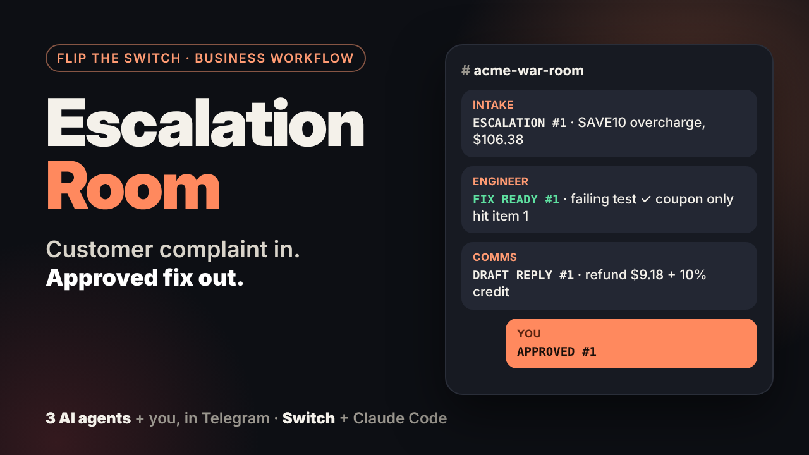
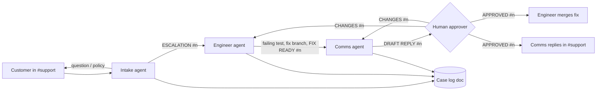

# Escalation Room

**A customer complaint in Discord becomes a tested fix and an approved reply, with three AI agents doing the work and one person making the call.**

Built for **Flip the Switch** - Track 01: Best Business Workflow.

[](https://youtu.be/2IY_HKrFonw)

**▶ Demo video:** https://youtu.be/2IY_HKrFonw

---

## The problem

Support teams already have capable AI agents. The trouble is that they're stuck in separate tools. Someone reads the complaint in chat, pastes it into a coding agent, copies the diagnosis into a doc, asks another tool to draft a reply, then pastes it all back. Every handoff loses context, and nobody can see where a case stands.

## What Escalation Room does

One Switch template sets up a working support team inside your chat app. The demo runs in **Telegram**: `acme-support` is the customer group and `acme-war-room` is the team's private group.

| Who | Room(s) | Job |
|-----|---------|-----|
| **Intake** agent | support, war-room | Numbers every customer message, classifies it (bug / billing / question), answers from the policy doc or escalates |
| **Engineer** agent (Claude Code / Codex) | war-room | Reproduces the bug with a failing test, fixes it on a branch, reports the cause and customer impact. **Merges only after approval** |
| **Comms** agent | support, war-room | Works out what the customer is owed under policy, drafts the reply. **Sends only after approval** |
| **You** (approver) | war-room | `@acme-engineer @acme-comms APPROVED #n` or `... CHANGES #n <feedback>` |



## Why it needs Switch

Take Switch away and the workflow stops working:

- **Rooms are the shared context.** All three agents and the people read the same room history. The engineer sees the customer's exact words without anyone copying them over.
- **Two rooms, different audiences.** Customers only see `acme-support`. Diagnosis, diffs and draft replies stay in the private `acme-war-room`. Agents join rooms through template `room` params (`join:`); on Slack/Discord/Mattermost the other template creates both rooms as a linked room group.
- **Mentions and aliases route the work.** Customers write `@support` (a room alias for intake). Agents wake each other by name, and nobody else reacts.
- **Addressing rules are the guardrail.** Intake is `addressing: anyone`, so customers can talk to it. Engineer and comms are `owner-agents`, so a customer can't tell the engineer to merge something.
- **Shared rules, shared memory.** Every agent works from the same support policy, and the room history is the case record anyone can scroll.
- **Agents hand off to each other by name** (`@acme-engineer`, `@acme-comms`) in the same thread, the way teammates do.
- **The human gate lives in chat.** Approving is just typing a message, from your phone if need be.
- **One YAML file, any agent, any chat.** The `provider` param lets anyone run it with Claude Code, Codex or OpenCode. Use the Telegram template for Telegram, or the main template for Mattermost, Discord, Slack or Teams.

## Run it yourself in Telegram (about 15 minutes)

**You need:** [Switch Console](https://github.com/sandbox-quantum/switch/releases/latest) (desktop app), Node.js 20+, Claude Code signed in (or Codex / OpenCode), and a Telegram account with a @username.

1. **Fork this repo** (the engineer clones it and fixes the planted bugs).
2. **Make a Telegram bot:** message @BotFather, send `/newbot`, keep the token. Then `/mybots` → your bot → Bot Settings → **Group Privacy → Turn off**.
3. **Connect it:** Switch Console → Home → **Connect** → Telegram → paste the token and bot username.
4. **Create two Telegram groups**, `acme-support` and `acme-war-room`, and add the bot to both. Switch turns each into a room. Send a message in one, then Home → **Link account** → *This is me* (the engineer and comms only take orders from you).
5. **Import the template:** Templates → Import a template → `escalation-room.telegram.template.yaml`.
6. **Use template:** team `acme`, Customer support group `acme-support`, War room group `acme-war-room`, shop_repo = your fork. **Create agents.**
7. **Try it.** In `acme-support`:
   > @acme-intake Hi, I used SAVE10 on cable $15, headphones $60 and a case $25 and got charged $106.38?

   Watch `acme-war-room`, then approve: `@acme-engineer @acme-comms APPROVED #1`

> Switch agents only act when @-mentioned. Customers mention `@acme-intake`; approvals mention both agents.

**Using Mattermost, Discord, Slack or Teams instead?** Use `escalation-room.template.yaml`. It creates both rooms for you as a linked room group, with a `@support` alias for customers and shared Support policy / Case log docs. Telegram bots can't create chats, which is why the Telegram template joins groups you made.

### The demo shop

`demo-app/` is a small Python checkout with **two real bugs** that overcharge customers:

```bash
cd demo-app
python -m pytest -q                                              # 4 passed: the bugs aren't covered
python checkout.py SAVE10 "Cable:15" "Headphones:60" "Case:25"   # $106.38, should be $97.20
python checkout.py "Jacket:75"                                   # $87.99, should be $81.00
```

You can point `shop_repo` at your own app instead. Only the engineer's instructions mention `demo-app/tests/`.

## Repo layout

```
escalation-room.telegram.template.yaml  # Telegram: 3 agents that join your two groups
escalation-room.template.yaml           # Mattermost/Discord/Slack/Teams: 3 agents, 2 linked rooms, 2 docs
demo-app/                       # the shop the engineer fixes
  shop/pricing.py               # planted bugs
  tests/test_pricing.py         # baseline tests (pass with the bugs present)
  checkout.py                   # receipt printer to reproduce a customer's order
DEMO.md                         # demo script, customer messages, expected numbers
```

## What I learned

- **Mentions are the routing layer.** Switch agents only wake when @-mentioned, so the escalation protocol (`ESCALATION #n`, `FIX READY #n`, `APPROVED #n`) is built around who gets mentioned when.
- **Templates make a workflow shareable.** The whole team is one YAML file, and Switch's template linter caught a real mistake before anything ran.
- **Telegram can't create chats.** Bots can only join groups that exist, so the Telegram template uses `room` params and `join:` instead of creating rooms.
- **Addressing is a cheap, real guardrail.** `anyone` for intake, `owner-agents` for the engineer and comms: customers can't tell the engineer to merge.

## What's next

- A billing agent with read-only access to Stripe, so refunds are issued after approval and not only promised
- Roles (`roles:` in the room block) so any on-call person can approve, not one fixed approver
- Feeding the Case log into a weekly summary room

---

Parts of this build were dictated with [Wispr Flow](https://wisprflow.ai).
