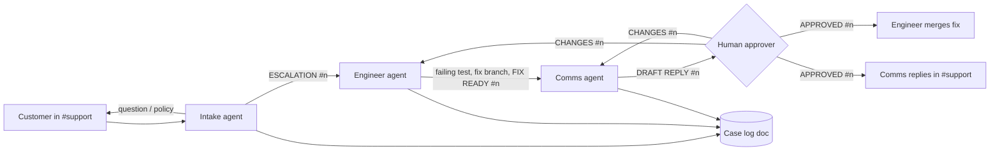

# Escalation Room

**A customer complaint in Discord becomes a tested fix and an approved reply, with three AI agents doing the work and one person making the call.**

Built for **Flip the Switch** - Track 01: Best Business Workflow.

 <!-- replace with your GIF or video link -->

**Video:** <!-- YouTube / Loom link -->

---

## The problem

Support teams already have capable AI agents. The trouble is that they're stuck in separate tools. Someone reads the complaint in chat, pastes it into a coding agent, copies the diagnosis into a doc, asks another tool to draft a reply, then pastes it all back. Every handoff loses context, and nobody can see where a case stands.

## What Escalation Room does

One Switch template sets up a working support team inside your chat app:

| Who | Room(s) | Job |
|-----|---------|-----|
| **Intake** agent | support, war-room | Numbers every customer message, classifies it (bug / billing / question), answers from the policy doc or escalates |
| **Engineer** agent (Claude Code / Codex) | war-room | Reproduces the bug with a failing test, fixes it on a branch, reports the cause and customer impact. **Merges only after approval** |
| **Comms** agent | support, war-room | Works out what the customer is owed under policy, drafts the reply. **Sends only after approval** |
| **You** (approver) | war-room | `@acme-engineer @acme-comms APPROVED #n` or `... CHANGES #n <feedback>` |



## Why it needs Switch

Take Switch away and the workflow stops working:

- **Rooms are the shared context.** All three agents and the people read the same room history. The engineer sees the customer's exact words without anyone copying them over.
- **Two linked rooms, different audiences.** Customers only see `#support`. Diagnosis, diffs and draft replies stay in the private `#war-room`. This uses Switch room groups and `links:`.
- **Mentions and aliases route the work.** Customers write `@support` (a room alias for intake). Agents wake each other by name, and nobody else reacts.
- **Addressing rules are the guardrail.** Intake is `addressing: anyone`, so customers can talk to it. Engineer and comms are `owner-agents`, so a customer can't tell the engineer to merge something.
- **Room docs are shared memory.** Intake and comms answer from the **Support policy** doc. Every agent updates the **Case log** doc.
- **Agents hand off to each other by name** (`@acme-engineer`, `@acme-comms`) in the same thread, the way teammates do.
- **The human gate lives in chat.** Approving is just typing a message, from your phone if need be.
- **One YAML file, any agent, any chat.** The `provider` and `bridge` params let anyone run it with Claude Code, Codex or OpenCode, on Discord, Slack, Teams or Mattermost.

## Run it yourself (about 10 minutes)

**You need:** [Switch Console](https://github.com/sandbox-quantum/switch) (desktop app, runs a local server in Docker), Docker, one coding agent signed in (Claude Code, Codex or OpenCode), and a Discord server where you can add a bot (or Slack/Teams/Mattermost).

1. **Fork this repo**, then tag the buggy starting point:
   ```bash
   git tag demo-start && git push --tags
   ```
2. **Install Switch Console** and connect your chat app (Console -> Messaging apps). Follow the Switch getting-started docs for Discord.
3. **Import the template:** Console -> Templates -> Import -> `escalation-room.template.yaml`.
4. **Create from template:**
   - `team`: e.g. `acme`
   - `shop_repo`: your fork's URL
   - `bridge`: Discord
   - Leave the rest at their defaults (you're the approver).
5. Two channels appear, `#acme-support` and `#acme-war-room`, and the three agents say hello.
6. **Post a complaint** in `#acme-support` (ready-made ones are in [DEMO.md](DEMO.md)), for example:
   > @support I used SAVE10 on cable $15, headphones $60 and a case $25, and got charged $106.38?
7. Watch the war room, then type `@acme-engineer @acme-comms APPROVED #1`.

> **Tip:** Switch agents only act when @-mentioned. Customers reach intake through the `@support` alias set in the template.

### The demo shop

`demo-app/` is a small Python checkout with **two real bugs** that overcharge customers:

```bash
cd demo-app
python -m pytest -q                                              # 4 passed: the bugs aren't covered
python checkout.py SAVE10 "Cable:15" "Headphones:60" "Case:25"   # $106.38, should be $97.20
python checkout.py "Jacket:75"                                   # $87.99, should be $81.00
```

You can point `shop_repo` at your own app instead. Only the engineer's instructions mention `demo-app/tests/`.

## Repo layout

```
escalation-room.template.yaml   # the whole workflow: 3 agents, 2 linked rooms, 2 docs
demo-app/                       # the shop the engineer fixes
  shop/pricing.py               # planted bugs
  tests/test_pricing.py         # baseline tests (pass with the bugs present)
  checkout.py                   # receipt printer to reproduce a customer's order
DEMO.md                         # demo script, customer messages, expected numbers
```

## What I learned

<!-- 3-4 honest bullets: what surprised you about rooms/addressing, what broke, what you'd add next -->

## What's next

- A billing agent with read-only access to Stripe, so refunds are issued after approval and not only promised
- Roles (`roles:` in the room block) so any on-call person can approve, not one fixed approver
- Feeding the Case log into a weekly summary room

---

Built by voice with [Wispr Flow](https://wisprflow.ai): prompts, agent instructions and this README were dictated. Scorecard in `assets/wispr-scorecard.png`.
